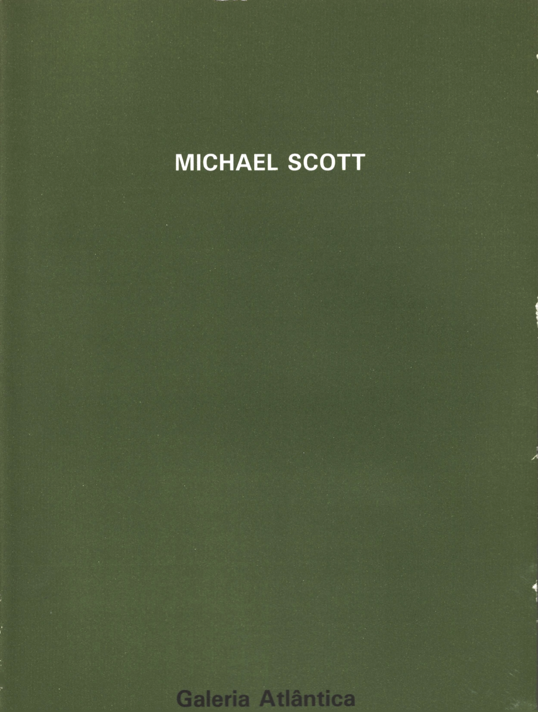

# Recluse
Exhibition at Galeria Nasoni in Porto, Portugal in 1991.

Text by Michael Archer in [Portuguese](Recluse-Portuguese.md) and [English](Recluse-English.md).

[Program](CASIO-fx-7200G.md) used to configure the paintings on a CASIO fx-7200G calculator.

